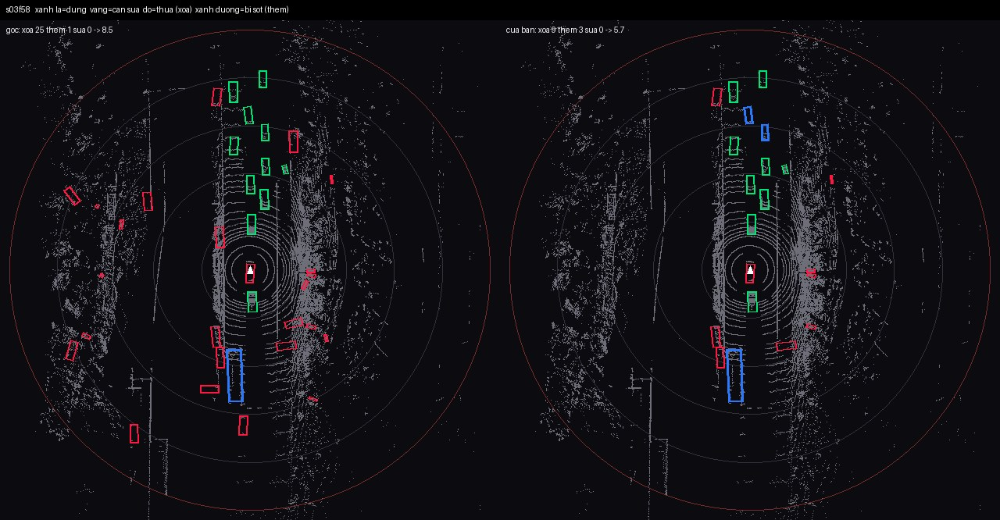

# Báo cáo Day 14 — Trần Thị Ngọc Ánh — 2A202603157

- Mã học viên dùng với `--student`: `157`
- `seed_tag` trong `frames_A.txt`: `393590736f`

## 1. Dự đoán trước sweep (bước 5b)

- Dự đoán trước khi chạy sweep: tăng `score_thr` từ `0.1` lên `0.3` và giữ `min_points=0` sẽ giảm công sửa nhiều nhất.
- Cơ sở dự đoán: Với cấu hình gốc trên tập A, có 53 hộp cần xóa, 4 hộp cần thêm và 1 hộp cần sửa. Riêng hai frame `s03f58` và `s05f24` đã có 46 hộp cần xóa. Việc nâng ngưỡng tin cậy lên `0.3` được kỳ vọng sẽ giảm số hộp thừa; `min_points` vẫn giữ ở `0` để tránh lọc mất các vật thật có ít điểm LiDAR.

## 2. Tập A: sửa tay và tune

Sau khi rà soát và chỉnh cuboid trên 3 frame tập A trong CVAT, nhãn được xuất thành `ref_A.json`. Bộ nhãn này được dùng để đo chi phí của cấu hình gốc và 15 tổ hợp `score_thr` × `min_points`.

| Cấu hình | `score_thr` | `min_points` | Xóa | Thêm | Sửa | Chi phí |
|---|---:|---:|---:|---:|---:|---:|
| Gốc | 0.1 | 0 | 53 | 4 | 1 | 20,4 |
| `best_config.json` | 0.4 | 0 | 22 | 7 | 1 | 14,1 |

Cấu hình tốt nhất trên tập A tăng `score_thr` từ `0.1` lên `0.4` và giữ `min_points=0`. Ở cùng ngưỡng `score_thr=0.4`, tăng `min_points` lên `5` hoặc `10` làm chi phí tăng từ 14,1 lên 15,1. Trong cả hai trường hợp, số hộp cần xóa và cần sửa giữ nguyên, còn số hộp cần thêm tăng từ 7 lên 8.

### Kết quả leave-one-out

Mỗi lượt chọn cấu hình trên hai frame rồi đo chi phí trên frame còn lại.

| Frame dùng để kiểm tra | Cấu hình chọn từ hai frame còn lại | Chi phí trên frame kiểm tra | Chi phí thấp nhất trong lưới trên frame đó |
|---|---|---:|---:|
| `s03f58` | `score_thr=0.4, min_points=0` | 5,7 | 5,7 |
| `s04f48` | `score_thr=0.4, min_points=0` | 0,6 | 0,6 |
| `s05f24` | `score_thr=0.4, min_points=0` | 7,8 | 7,8 |

Cả ba lượt đều chọn `score_thr=0.4, min_points=0` và đạt chi phí thấp nhất trên frame kiểm tra. Vì vậy, cấu hình này được dùng để tạo pre-label cho tập B. Kết quả cho thấy lựa chọn khá ổn định trong phạm vi ba frame tập A; hiệu quả trên tập B được đánh giá sau khi rà soát và chỉnh đủ 12 frame.

## 3. Trước/sau (bước 8)

*Ảnh BEV của frame `s03f58`. Bên trái là cấu hình gốc, bên phải là cấu hình sau tune. Xanh lá là hộp giữ nguyên, vàng là hộp cần sửa, đỏ là hộp thừa cần xóa và xanh dương là vật bị sót cần thêm hộp.*

| Frame | Chi phí gốc | Chi phí sau tune | Mức giảm |
|---|---:|---:|---:|
| `s03f58` | 8,5 | 5,7 | 2,8 |
| `s04f48` | 2,1 | 0,6 | 1,5 |
| `s05f24` | 9,8 | 7,8 | 2,0 |
| **Tổng** | **20,4** | **14,1** | **6,3** |

`pp_compare.py` báo chi phí sửa giảm khoảng **31% trên tập A**. Sau khi tune, số hộp cần xóa giảm từ **53 xuống 22**, số hộp cần thêm tăng từ **4 lên 7**, còn số hộp cần sửa giữ ở **1**. Theo trọng số của bài, giảm 31 hộp cần xóa tiết kiệm 9,3 điểm chi phí, còn 3 hộp cần thêm làm tăng 3,0 điểm. Mức giảm ròng là **6,3 điểm**.

Dự đoán trước sweep đúng về hướng điều chỉnh nhưng chưa đúng về ngưỡng tối ưu. Với `score_thr=0.3` và `min_points=0`, số hộp cần xóa giảm từ 53 xuống 38, số hộp cần thêm vẫn là 4 và số hộp cần sửa vẫn là 1. Chi phí nhờ đó giảm xuống **15,9**. Khi tăng tiếp `score_thr` lên `0.4`, số hộp cần xóa giảm thêm 16, còn số hộp cần thêm tăng 3. Tổng chi phí giảm xuống **14,1**, thấp nhất trong 15 cấu hình đã thử. Ở ngưỡng `0.5` với `min_points=0`, số hộp cần thêm tăng lên 13 và chi phí tăng trở lại **17,1**.

## 4. Tập B

Cấu hình `score_thr=0.4, min_points=0` được dùng để tạo pre-label cho 12 frame tập B. Sau khi rà soát và chỉnh cuboid trong CVAT, nhãn được xuất thành `ref_B.json` để làm tham chiếu khi đo chi phí sửa.

Script ghi nhận 139 cuboid tham chiếu và 241 cuboid dự đoán, trong đó 132 cuboid dự đoán ghép được với nhãn tham chiếu.

| Xóa | Thêm | Sửa | Chi phí |
|---:|---:|---:|---:|
| 109 | 7 | 3 | 41,2 |

Chi phí được tính bằng `0,3 × 109 + 1,0 × 7 + 0,5 × 3 = 41,2` điểm. Nhóm hộp tốn nhiều công sửa nhất theo thước đo của bài là hộp dự đoán thừa cần xóa, chiếm 32,7 trên tổng 41,2 điểm. Frame `s01f00` có chi phí cao nhất (6,5 điểm) với 10 hộp cần xóa, 3 hộp cần thêm và 1 hộp cần sửa.

## 5. Giới hạn

- Tập A chỉ có 3 frame. Cấu hình có chi phí thấp nhất trên tập A có thể cho kết quả khác trên tập B.
- PointPillars huấn luyện trên KITTI chỉ học trực tiếp ba lớp. Các hộp Truck và Bus cần được kiểm tra lại bằng LiDAR và camera.
- Chi phí sửa là điểm tính theo trọng số của thao tác xóa, thêm và sửa. Bài đo này chưa ghi thời gian thao tác thực tế.
